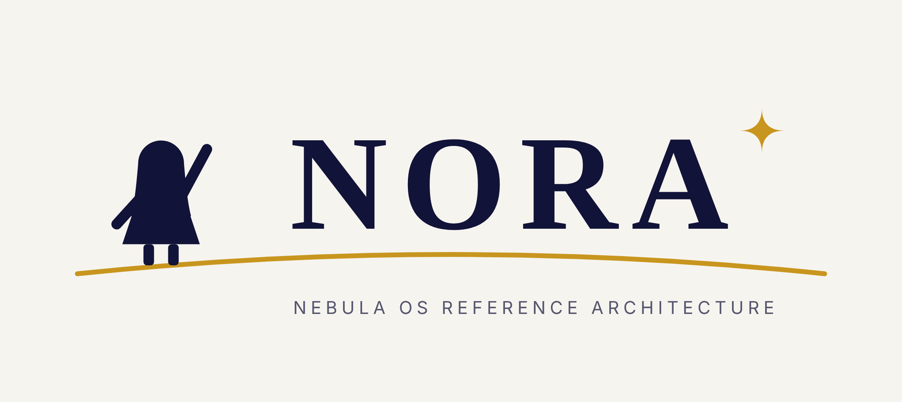

<p align="center">
  <picture>
    <source media="(prefers-color-scheme: dark)" srcset="docs/images/nora-logo-dark.png">
    <source media="(prefers-color-scheme: light)" srcset="docs/images/nora-logo-light.png">
    
  </picture>
</p>

# NORA

NORA (Nebula OS Reference Architecture): the open sources of the Nebula
hypervisor with the hypervisor's kernel, zircon, built from source: Open
Trust Group's zircon, which keeps Nebula's system call interface, so that the
open garnet, HEE and REE build and run on it. It builds and runs the whole
system in QEMU.

## Get it

With [jiri](https://fuchsia.googlesource.com/jiri), Fuchsia's checkout
tool:

```sh
curl -s "https://fuchsia.googlesource.com/jiri/+/HEAD/scripts/bootstrap_jiri?format=TEXT" |
    base64 --decode | bash -s nebula
cd nebula
export PATH=$PWD/.jiri_root/bin:$PATH
cat > .jiri_manifest <<'EOF'
<manifest>
  <imports>
    <import name="NORA" manifest="manifest/NORA" root=""
            remote="https://github.com/OpenTrustGroup/NORA" remotebranch="main"/>
  </imports>
</manifest>
EOF
jiri update
nora/fetch-assets.sh   # toolchains, bazel and its downloads, QEMU's subprojects
```

`manifest/NORA` follows `main` and, for each fork of upstream and for
zircon, its branch `NORA`: `jiri update` brings the latest release. A
release is this repository's tag and, in each fork and in zircon, the tag
`NORA-<version>`.

## Run on QEMU

```sh
nora/build.sh
source scripts/env.sh && fx run-venus -z -9 -d
```

builds zircon, the hypervisor image, linux 6.6 and its root file system,
TF-A and QEMU, and boots the hypervisor, which starts the SOS guest. NORA
has no TEE: TF-A is built without one (`--tee none`) and nothing runs in
the secure world. Besides the assets, the host needs the device-tree
compiler, `dtc` (Debian and Ubuntu: `device-tree-compiler`), which
garnet's build runs. In tmux, add `-x` to `fx run-venus`: the serial
consoles open as tmux windows rather than terminal windows.

## What is in here

- `manifest/NORA`: the projects, for jiri.
- `docs/images/`: the NORA logo, for GitHub's dark and light themes.
- `nora/`: the build (`build.sh`, which runs `build-zircon.sh` first),
  NORA's packages (`product/default/`), the assets (`fetch-assets.sh`,
  `ASSETS.sha256`, and `make-assets.sh`, which makes them from where their
  makers publish them), what the GN build reads that NORA does not carry
  (`gn-stubs/`), and stand-ins for Trusty's user library, as NORA has no
  TEE (`trusty/`).
